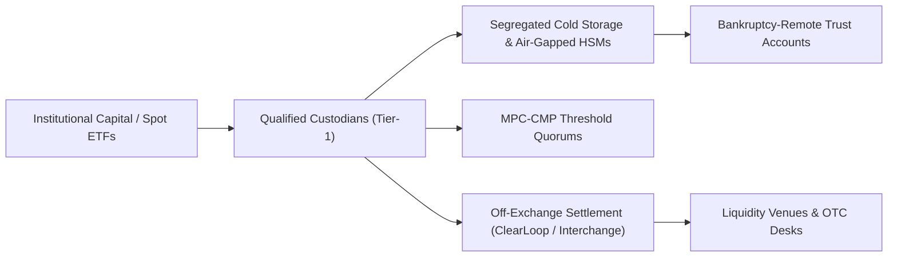
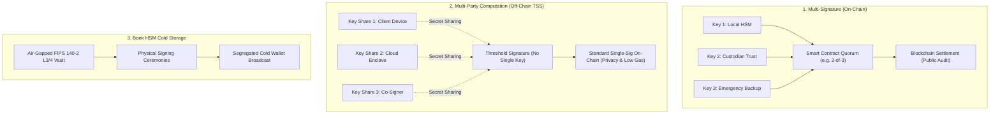

  

  
  
  
  
  
  

---

# 🏛️ Awesome Third-Party Custodian in Crypto & Digital Assets 🔐

> A curated directory of premier **SaaS custody platforms**, **qualified digital asset custodians**, **MPC (Multi-Party Computation) key management frameworks**, and **open-source cryptographic custody infrastructure**. Engineered for institutional allocators, crypto hedge funds, family offices, ETF sponsors, and Web3 protocol builders.

---

## 📑 Table of Contents
- [📊 Sector Overview & Market Dynamics](#-sector-overview--market-dynamics)
- [🏢 SaaS & Hosted Custody Platforms](#-saas--hosted-custody-platforms)
  - [Detailed SaaS Platform Highlights](#-detailed-saas-platform-highlights)
- [🔓 Open-Source GitHub Projects & Libraries](#-open-source-github-projects--libraries)
- [🧭 Custody Architecture Comparison (MPC vs Multi-Sig vs HSM)](#-custody-architecture-comparison)
- [⚖️ Regulatory Matrix & Compliance Standards](#-regulatory-matrix--compliance-standards)
- [🤝 How to Contribute](#-how-to-contribute)
- [💖 Support](#-support)
- [⭐ Star History](#-star-history)
- [📜 Disclaimer](#-disclaimer)

---

## 📊 Sector Overview & Market Dynamics

The global institutional crypto custody market secures approximately **$953.5 Billion in Assets Under Custody (AUC) in 2026** and is on pace to surpass **$4.38 Trillion by 2030**, advancing at a compound annual growth rate (**CAGR of 23.6%**). Pure-play crypto custody software, infrastructure licensing, and transaction fee revenues represent an estimated **$1.6 Billion to $4.65 Billion** market globally.

### 🎯 Market Concentration & Competitive Landscape
The institutional custody sector is **highly concentrated (oligopolistic / winner-take-most)**:
- **The Qualified Tier-1 Oligopoly**: A select group of institutional titans—namely **Coinbase Custody**, **BitGo**, **Fireblocks**, **Anchorage Digital**, and **Fidelity Digital Assets**—safeguards over **75% of global institutional digital asset holdings**, including the vast majority of spot Bitcoin and Ethereum ETF reserves. This high concentration is sustained by profound structural barriers to entry: federal and state bank charters (e.g., OCC, South Dakota, NYDFS BitLicense), SOC 1 & SOC 2 Type II accreditations, and multi-hundred-million-dollar syndicated specie insurance policies via Lloyd's of London syndicates.
- **Emerging Fragmentation in Tooling & Sovereign Tech**: While qualified asset safekeeping remains tightly consolidated, healthy fragmentation exists across **Wallet-as-a-Service (WaaS)** APIs, **self-hosted MPC threshold signature schemes (TSS)**, and regional custodians servicing emerging financial hubs across the European Union (MiCA), Switzerland (FINMA), the United Arab Emirates (VARA), and Singapore (MAS).

---

## 🏢 SaaS & Hosted Custody Platforms

The table below benchmarks the top commercial crypto custody and key infrastructure providers, sorted in **descending order by company size** (market capitalization, private valuation, or parent scale).

| 🏢 Platform | 📈 Company Size (Valuation / Revenue) | 💳 Starting Pricing | 🎁 Free Tier / Free Trial Limits | 🛡️ Key Architecture & Model | 🌐 Regulatory Status |
| :--- | :--- | :--- | :--- | :--- | :--- |
| **[Tether](https://tether.io/)** | **$100B+ Implied Valuation** ($181B+ reserves; $10B+ net profit in Q1-Q3 2025) | **0.10% (10 bps)** deposit/redemption fee + **$1,000** one-time verification fee ($100k min) | **No free trial for reserve custody** (requires $100k KYC deposit; testnet USDT smart contracts are free on Ethereum Sepolia/Holesky) | Sovereign reserve cold vaults, multi-custodial bank deposits & physical gold depositories | BVI FSC registered, Italian AML registered, VASP frameworks |
| **[Coinbase Custody](https://www.coinbase.com/prime)** | **$62B Market Cap** (NASDAQ: COIN; $3.1B+ rev, $300B+ AUC) | **50 bps (0.50%)** annualized AUC with **$2,400/year ($200/mo)** minimum floor; $500k min balance | **Free Forever Developer Tier** on Coinbase Developer Platform (up to 10,000 monthly active users / RPC credits for wallet API; Prime institutional custody requires sales onboarding) | Geographically distributed MPC key shares, NSA/NCSC-grade Cross Domain Solutions (CDS), cold air-gap | NYDFS Trust Charter, SEC Qualified Custodian, SOC 1/2 Type II |
| **[Fidelity Digital Assets](https://clearingcustody.fidelity.com/)** | **$50B+ Parent Valuation** (Fidelity Investments $5.4T total AUM) | **25–40 bps (0.25%–0.40%)** annualized AUC with **$2,500/month** platform floor ($500k account min) | **30-day institutional Proof of Concept (POC)** sandbox on staging environment for vetted RIAs and institutional allocators | Physical segregated vaults, multi-tier air-gapped cryptographic signing ceremonies | OCC National Trust Bank, NYDFS BitLicense, UK FCA registered |
| **[Fireblocks](https://www.fireblocks.com/)** | **$8.0B Valuation** (Series E; $150M+ ARR, $14T+ transferred) | **$999/month** (Essentials tier, up to $1M quarterly transfer volume; custom tiers from $36,000/yr) | **Free Forever Developer Sandbox** (Unlimited testnet API transactions, MPC wallet generation, policy engine rules, and SDK access across 70+ testnet chains) | MPC-CMP (Threshold Cryptography), SGX/Nitro secure enclaves, rule-based Policy Engine | SOC 2 Type II, ISO 27001, CCSS Level 3 certified |
| **[Anchorage Digital](https://www.anchorage.com/)** | **$4.2B Valuation** (Series D led by KKR, Goldman Sachs, a16z) | **$750/month** (Porto software tier for <$1M balance; bank custody 25–35 bps AUC with $1,500/mo min) | **14-day free trial** for Porto software tier (up to $1M simulated/testnet volume) + free testnet developer API access | Biometric quorum signing, multi-sig hardware enclaves, tri-party collateral structures | OCC Federally Chartered Bank, NYDFS BitLicense, MAS Major Payment Institution |
| **[Copper.co](https://copper.co/)** | **$2.0B Valuation** (Series C; backed by Barclays, Dawn Capital) | **15–25 bps** annualized AUC with **$2,500/month** baseline connectivity floor for ClearLoop | **30-day proof-of-concept (POC) sandbox** on testnet staging environment upon compliance pre-qualification | MPC-based key shards, ClearLoop off-exchange collateral settlement engine | SOC 2 Type 2, ISO 27001, Switzerland VQF, UK FCA registered |
| **[BitGo](https://www.bitgo.com/)** | **$1.75B Valuation** (Series C; $100B+ AUC, 1,500+ institutional clients) | **10–25 bps** annualized AUC (or **0.25% per transaction** for hot/warm wallets) with **$1,000/mo** minimum fee | **Free Forever Developer Portal & Testnet** (Unlimited testnet wallet creation, multi-sig key signing, and REST API calls on Bitcoin/Ethereum testnets) | Multi-signature (P2SH/P2WSH) & TSS MPC architectures, $250M Lloyd's insurance | South Dakota Trust Company, NYDFS Trust Charter, BaFin (Germany), MAS |
| **[Ledger Enterprise](https://enterprise.ledger.com/)** | **$1.5B Valuation** (€1.3B Series C; secures 20%+ of world crypto assets) | **$1,250/month** ($15,000/year base platform license + 10–20 bps on AUC/transfers) | **30-day enterprise evaluation pilot** (includes 2 Ledger hardware security modules on staging network) | BOLOS OS secure hardware enclaves, multi-operator governance rules, TRADELINK network | SOC 2 Type II, ISO 27001, ANSSI certified hardware |
| **[Taurus (Taurus-PROTECT)](https://www.taurushq.com/)** | **$350M Valuation** (Series B $65M led by Credit Suisse & Deutsche Bank) | **€2,500/month (~$2,700/mo)** for Taurus-PROTECT software license + 15 bps on AUC | **30-day sandbox pilot** on testnet with full API/CLI access and multi-tenant policy simulation | FIPS 140-2 Level 3 & Level 4 HSM integration (Securosys/Thales), multi-signature & MPC | FINMA regulated (Switzerland), ISO 27001, SOC 2 Type II |
| **[Hex Trust](https://www.hextrust.com/)** | **$300M Valuation** (Series B $88M; Animoca Brands, Morgan Creek) | **$1,500/month** (Hex Safe base tier + 20–30 bps annualized AUC) | **14-day staging sandbox access** (includes simulated multi-enterprise approval workflows and testnet signing) | Securosys Primus X200 HSM (FIPS 140-2 Level 3), cold storage SLA <2h, warm instant | HK Trust/TCSP, Singapore MAS MPI, Dubai VARA, France AMF |
| **[Cobo (Custody & WaaS)](https://www.cobo.com/)** | **$300M Valuation** (Series B led by DST Global & A&T Capital; $4B+ AUC) | **$299/month** (Starter: 2 users, 6,000 addresses, $300k/mo transfer vol; Standard: $999/mo) | **14-day full-access free trial** (MPC wallets, API integration pipeline, no credit card required) + free developer testnet | Omnichannel custody: Full Qualified Custody, MPC WaaS, & Cobo Argus on-chain smart rules | SOC 2 Type II, ISO 27001, Dubai VARA, Hong Kong TCSP, US MSB |
| **[Zodia Custody](https://zodia-custody.com/)** | **$180M Valuation** (Standard Chartered, Northern Trust, SBI Holdings, NAB) | **25 bps** annualized AUC with **£1,500/month (~$1,900/mo)** minimum platform commitment | **30-day proof-of-concept (POC) staging sandbox** for regulated financial institutions upon onboarding check | KMS-agnostic bank-grade architecture; client retains key ownership in bank infra | UK FCA registered, Ireland CBI, Luxembourg CSSF, France AMF |
| **[Komainu](https://komainu.com/)** | **$150M Valuation** (Nomura, CoinShares, Ledger JV; $75M raised) | **20–30 bps** annualized AUC with **$2,000/month** platform operational floor | **30-day institutional testnet integration sandbox** for validated counterparties | Hybrid hardware security modules (HSM) + Blockstream Liquid off-exchange collateral rails | Jersey JFSC regulated, UK FCA registered, Dubai VARA licensed |
| **[Dfns](https://www.dfns.co/)** | **$100M Valuation** (Series A; backed by White Star Capital, Hashed, Coinbase) | **$50–$66/month** ($800/yr Starter: 1 org, 1 user, 100 wallets, 1 blockchain; Basic: $8,000/yr) | **30-day free trial** (Full sandbox environment on testnets, no credit card required) | Stateless MPC key generation, zero-knowledge biometric signatures (FIDO2 / WebAuthn) | SOC 2 Type II, ISO 27001 compliant |

---

### 🔍 Detailed SaaS Platform Highlights

#### 1. 🪙 [Tether](https://tether.io/)
- **Profile**: Issuer of USD₮ and reserve custodian safeguarding **$181B+ in reserves** (comprising $135B+ in U.S. Treasury bills, $12.9B in physical gold, and $9.9B in Bitcoin).
- **Core Role**: While not a generic multi-tenant custody API for client assets, Tether operates the largest institutional balance sheet and private reserve safekeeping vault infrastructure in digital asset history.
- **Auditing**: Publishes quarterly assurance opinions verified by BDO Italia.

#### 2. 🛡️ [Coinbase Custody / Coinbase Prime](https://www.coinbase.com/prime)
- **Profile**: Publicly traded institutional custodian securing **~12% of total crypto market cap** across 40+ Layer-1 and Layer-2 blockchains.
- **Core Role**: Official custody custodian and prime execution partner for 8 of the 11 approved US spot Bitcoin ETFs (including BlackRock iShares IBIT).
- **Security**: Geographically distributed key ceremonies, hardware enclaves, NSA/NCSC-reviewed Cross Domain Solutions, and SOC 1 & SOC 2 Type II attestation.

#### 3. 🏦 [Fidelity Digital Assets](https://clearingcustody.fidelity.com/)
- **Profile**: Digital asset subsidiary of Fidelity Investments ($5.4T+ total assets under administration).
- **Core Role**: Institutional custody, trade execution, and collateral management designed for registered investment advisors (RIAs), corporate treasuries, and hedge funds.
- **Security**: Physically secure private vaults with customized quorum authorization and deep cold storage.

#### 4. 🔥 [Fireblocks](https://www.fireblocks.com/)
- **Profile**: Global enterprise infrastructure provider securing **$14T+ in cumulative transactions** across 2,400+ institutions.
- **Core Role**: Powers digital asset custody for banks, fintechs (Revolut, Robinhood, BNY Mellon), and crypto-native institutions.
- **Security**: MPC-CMP threshold signing protocols, real-time transaction screening policy engine, and the Fireblocks Network for counterparty settlement.

#### 5. 🏛️ [Anchorage Digital](https://www.anchorage.com/)
- **Profile**: The only **federally chartered digital asset bank in the United States**, operating under Office of the Comptroller of the Currency (OCC) supervision.
- **Core Role**: Qualified custody, staking, governance voting from cold storage, and tri-party collateral structures (e.g., Lombard LBTC).
- **Security**: Hardware security modules, biometric quorum signing, and bankruptcy-remote segregated deposit accounting.

#### 6. ⚡ [Copper.co](https://copper.co/)
- **Profile**: Institutional custody and settlement pioneer founded in London in 2018.
- **Core Role**: Known for **ClearLoop**, the leading off-exchange collateral settlement network that connects institutional allocators directly to exchanges like OKX, Bybit, Deribit, and Kraken MTF without moving funds onto exchange hot wallets.
- **Security**: MPC threshold signature framework with $500M insurance capacity through Aon and Lloyd's of London syndicates.

#### 7. 🔒 [BitGo](https://www.bitgo.com/)
- **Profile**: Pioneer of commercial multi-signature wallets in 2013, safeguarding **$100B+ in assets under custody**.
- **Core Role**: Provides segregated qualified custody via BitGo Trust, institutional prime lending, staking, and Go Accounts for off-chain settlement.
- **Security**: Multi-sig and threshold MPC wallets with up to $250M Lloyd's of London insurance policy covering theft and key loss.

---

## 🔓 Open-Source GitHub Projects & Libraries

Below are the most prominent open-source repositories powering institutional crypto custody, threshold signature schemes (TSS), smart contract multi-sigs, and Key Management Systems (KMS). 

Repositories are **sorted strictly in descending order by GitHub stargazer count**.

---

### 1. [Trust Wallet Core](https://github.com/trustwallet/wallet-core) 
- **Repo**: `trustwallet/wallet-core`
- **Primary Stack**: C++, TypeScript, Swift, Kotlin
- **Category**: Cross-Platform Key Management & Signer Engine
- **Description**: Cross-platform library that implements cryptographic key management, transaction signing, and address encoding for over 60+ blockchain protocols. Widely used as the underlying cryptographic custody engine in enterprise and multi-chain wallet backends.

### 2. [Safe Smart Account](https://github.com/safe-global/safe-smart-account) 
- **Repo**: `safe-global/safe-smart-account` (formerly Gnosis Safe)
- **Primary Stack**: Solidity, TypeScript
- **Category**: Smart Contract Multi-Signature Custody & Account Abstraction (ERC-4337)
- **Description**: The industry standard for on-chain multi-signature asset management, securing over **$100B+ in treasury assets**. Features customizable M-of-N threshold quorums, modular guardian recovery, transaction batching, and pluggable account abstraction modules.

### 3. [ZenGo-X multi-party-ecdsa](https://github.com/ZenGo-X/multi-party-ecdsa) 
- **Repo**: `ZenGo-X/multi-party-ecdsa`
- **Primary Stack**: Rust
- **Category**: Threshold Cryptography (MPC-TSS)
- **Description**: Production-grade Rust implementation of `{t,n}`-Threshold ECDSA digital signature algorithms. Designed to eliminate single points of key compromise in Bitcoin and Ethereum wallet architectures without relying on on-chain multi-sig gas overhead.

### 4. [BNB Chain TSS-Lib](https://github.com/bnb-chain/tss-lib) 
- **Repo**: `bnb-chain/tss-lib`
- **Primary Stack**: Go
- **Category**: Threshold Signature Scheme (TSS) Library
- **Description**: Widely adopted Go implementation of Threshold Signature Schemes for ECDSA (secp256k1) and EdDSA (ed25519). Enables distributed key generation (DKG) and threshold signing across distrusting institutional parties.

### 5. [Coinbase Kryptology](https://github.com/coinbase/kryptology) 
- **Repo**: `coinbase/kryptology`
- **Primary Stack**: Go
- **Category**: Cryptographic Primitives & Threshold Protocols
- **Description**: Coinbase's foundational open-source cryptographic repository powering Coinbase Custody. Contains implementations of threshold ECDSA, DKG, Schnorr signatures, Shamir secret sharing, and zero-knowledge proof primitives.

### 6. [Specter Desktop](https://github.com/cryptoadvance/specter-desktop) 
- **Repo**: `cryptoadvance/specter-desktop`
- **Primary Stack**: Python, Flask, JavaScript
- **Category**: Air-Gapped Multisig Coordinator & Hardware Vault Interface
- **Description**: Desktop multisig coordinator designed for institutional and sovereign Bitcoin custody setups. Seamlessly coordinates air-gapped signing across hardware security keys (Ledger, Trezor, Coldcard, BitBox02) and connects directly to private Bitcoin Core nodes.

### 7. [Ledger Live](https://github.com/LedgerHQ/ledger-live) 
- **Repo**: `LedgerHQ/ledger-live`
- **Primary Stack**: TypeScript, JavaScript
- **Category**: Hardware-Enforced Custodial Interfaces & BOLOS SDK
- **Description**: Monorepo for Ledger's desktop and mobile custody suite, managing hardware security modules (HSMs) and secure enclaves (ST33 Secure Element) for private key isolation.

### 8. [Argent Contracts](https://github.com/argentlabs/argent-contracts) 
- **Repo**: `argentlabs/argent-contracts`
- **Primary Stack**: Solidity
- **Category**: Smart Contract Guardian Custody
- **Description**: Smart contract architecture pioneering guardian-based social recovery, session keys, and daily transfer limit policies. Replaces static seed phrases with institutional-grade on-chain governance.

### 9. [BitGoJS](https://github.com/BitGo/BitGoJS) 
- **Repo**: `BitGo/BitGoJS`
- **Primary Stack**: TypeScript, JavaScript
- **Category**: Enterprise Multi-Sig & MPC SDK
- **Description**: Official open-source client SDK for BitGo’s multi-signature and TSS custodial services. Allows developers to script automated cold-to-warm sweeps, sign multi-party transactions, and interact with 600+ digital assets.

### 10. [Taurus multi-party-sig](https://github.com/taurushq-io/multi-party-sig) 
- **Repo**: `taurushq-io/multi-party-sig`
- **Primary Stack**: Go
- **Category**: Threshold Cryptography (MPC-CMP)
- **Description**: Created by Taurus SA (Switzerland's premier institutional digital asset infrastructure firm). Provides clean, modular Go implementations of state-of-the-art threshold signature protocols for banking-grade key custody.

### 11. [Zcash Foundation FROST](https://github.com/ZcashFoundation/frost) 
- **Repo**: `ZcashFoundation/frost`
- **Primary Stack**: Rust
- **Category**: Flexible Round-Optimized Schnorr Threshold (FROST)
- **Description**: High-assurance Rust implementation of the FROST threshold signature scheme. Facilitates distributed Schnorr signatures with minimal network round latency, ideal for next-generation threshold custody across Taproot and Ed25519.

### 12. [MetaMask Torus Node](https://github.com/MetaMask/torus-node) 
- **Repo**: `MetaMask/torus-node`
- **Primary Stack**: Go
- **Category**: Distributed Key Generation (DKG) Network
- **Description**: Distributed threshold key generation and management nodes. Orchestrates key share assignment and recovery without any single party having access to the master private key.

### 13. [Unchained Capital Caravan](https://github.com/unchained-capital/caravan) 
- **Repo**: `unchained-capital/caravan`
- **Primary Stack**: JavaScript, HTML
- **Category**: Collaborative Multisig Coordinator & Key Recovery
- **Description**: Open-source, stateless collaborative custody tool created by Unchained Capital. Allows institutions and family offices to build transparent M-of-N Bitcoin multisig vaults using multiple hardware wallets with guaranteed offline key recovery.

### 14. [ING Bank Threshold Signatures](https://github.com/ing-bank/threshold-signatures) 
- **Repo**: `ing-bank/threshold-signatures`
- **Primary Stack**: Rust
- **Category**: Banking-Grade Threshold ECDSA Library
- **Description**: Production-oriented threshold ECDSA cryptographic library built by Dutch multinational bank ING. Provides distributed signature generation without assembling private keys, tailored for institutional bank custody integrations.

### 15. [fystack mpcium](https://github.com/fystack/mpcium) 
- **Repo**: `fystack/mpcium`
- **Primary Stack**: Go
- **Category**: Distributed MPC Wallet Framework
- **Description**: Lightweight open-source toolkit enabling developers to stand up distributed MPC custodial wallet clusters in minutes. Eliminates proprietary vendor lock-in for startups building custom key management.

### 16. [Safeheron multi-party-sig-cpp](https://github.com/Safeheron/multi-party-sig-cpp) 
- **Repo**: `Safeheron/multi-party-sig-cpp`
- **Primary Stack**: C++
- **Category**: High-Performance Threshold Signatures
- **Description**: Production C++ implementation of `{t,n}`-Threshold Signature Schemes optimized for low-latency hardware security modules and Intel SGX enclaves.

### 17. [Turnkey SDK](https://github.com/tkhq/sdk) 
- **Repo**: `tkhq/sdk`
- **Primary Stack**: TypeScript
- **Category**: Secure Enclave Custody & Policy SDK (Turnkey)
- **Description**: Official TypeScript SDK for Turnkey's cloud enclave infrastructure. Enables programmatic generation of crypto wallets inside AWS Nitro Enclaves with cryptographic quorum policies and WebAuthn/passkey signers.

### 18. [Fireblocks JS SDK](https://github.com/fireblocks/fireblocks-sdk-js) 
- **Repo**: `fireblocks/fireblocks-sdk-js`
- **Primary Stack**: TypeScript, JavaScript
- **Category**: Institutional Custody Automation SDK
- **Description**: Official client SDK for Fireblocks institutional custody platform. Enables automated hot wallet management, internal vault sweeps, gas station orchestration, and rule-based MPC transaction authorization.

### 19. [CubeSigner SDK](https://github.com/cubist-labs/CubeSigner-TypeScript-SDK) 
- **Repo**: `cubist-labs/CubeSigner-TypeScript-SDK`
- **Primary Stack**: TypeScript
- **Category**: Hardware-Backed Non-Exportable Key Manager (CubeSigner)
- **Description**: Client SDK for CubeSigner, a hardware-backed non-exportable key management platform. Enforces cryptographic transaction policies and multi-factor approval workflows inside secure hardware enclaves before signing.

### 20. [Fystack Custody Stack](https://github.com/fystack/fystack-selfhost-scripts) 
- **Repo**: `fystack/fystack-selfhost-scripts`
- **Primary Stack**: Shell, Docker, Go
- **Category**: Self-Hosted Custody Stack & Sweep Engine
- **Description**: Turnkey deployment scripts for self-hosting an institutional-grade crypto custody stack. Features MPC threshold signing nodes, multi-chain deposit detection across 10+ chains, automated cold sweeps, and RBAC governance.

### 21. [Fireblocks Disaster Recovery Tool](https://github.com/fireblocks/recovery) 
- **Repo**: `fireblocks/recovery`
- **Primary Stack**: TypeScript, Shell
- **Category**: Custody Continuity & Disaster Recovery
- **Description**: Standalone open-source recovery suite that allows Fireblocks clients to independently recover their private keys and digital assets in an extreme disaster scenario without connecting to Fireblocks cloud infrastructure.

### 22. [Dfns TypeScript SDK](https://github.com/dfns/dfns-sdk-ts) 
- **Repo**: `dfns/dfns-sdk-ts`
- **Primary Stack**: TypeScript
- **Category**: Stateless MPC Custody Client
- **Description**: Developer SDK to interact with Dfns' FIDO2/WebAuthn authenticated MPC wallet infrastructure. Enables developers to programmatically generate wallets and execute threshold policy signoffs.

### 23. [kms-secp256k1-api](https://github.com/Interchouette/kms-secp256k1-api) 
- **Repo**: `Interchouette/kms-secp256k1-api`
- **Primary Stack**: Rust, AWS KMS
- **Category**: Cloud KMS Custodial Wallet
- **Description**: Rust API service implementing custodial crypto wallets via AWS Key Management Service (KMS) using the secp256k1 curve. Ensures private keys never leave hardened cloud hardware security modules.

---

## 🧭 Custody Architecture Comparison

Institutional custodians separate into three foundational architectural models:

| Dimension | 🔐 Multi-Signature (e.g., Safe, BitGo) | ⚡ Multi-Party Computation (e.g., Fireblocks, ZenGo) | 🏛️ Hardware Security Modules (e.g., Taurus, Hex Trust) |
| :--- | :--- | :--- | :--- |
| **Key Location** | Distinct full private keys on individual devices/contracts | Sharded mathematical secrets (*shares*); key never assembled | Secure cryptographic microchips (FIPS 140-2 Level 3/4) |
| **Blockchain Agnosticism** | Requires native chain smart contracts (Ethereum/EVM, Bitcoin P2SH) | Universally compatible across secp256k1, ed25519, BLS | Universally compatible with supported cryptographic curves |
| **On-Chain Privacy** | Reveals signer addresses and governance threshold | Identical to a single-signature transaction on-chain | Standard single or multi-signature appearance |
| **Transaction Gas Costs** | Higher (scales with number of signers) | Minimum baseline network gas cost | Minimum baseline network gas cost |
| **Institutional Quorum Rules** | Enforced via smart contract logic | Enforced via off-chain policy engine & DKG protocol | Enforced via firmware authorization policies |

---

## ⚖️ Regulatory Matrix & Compliance Standards

Institutions selecting a third-party crypto custodian must evaluate compliance frameworks across key jurisdictions:

- **🇺🇸 United States**:
  - **OCC National Bank Charter**: Gold standard for federally chartered digital asset banks (e.g., Anchorage Digital). Provides federal preemption, fiduciary powers, and OCC oversight.
  - **NYDFS BitLicense & Limited Purpose Trust Company**: Strict New York Department of Financial Services framework enforcing capital reserves, cybersecurity standards, and AML policies (e.g., Coinbase Custody, BitGo Trust).
  - **SEC Rule 206(4)-2 (Custody Rule)**: Mandates that registered investment advisors (RIAs) maintain client funds with a "Qualified Custodian" to ensure bankruptcy remoteness.
- **🇪🇺 European Union**:
  - **MiCA (Markets in Crypto-Assets Regulation)**: Comprehensive uniform framework requiring crypto-asset service providers (CASPs) to maintain segregated client assets, minimum capital requirements, and audited recovery protocols.
  - **DORA (Digital Operational Resilience Act)**: Rigorous ICT risk-management, penetration testing, and third-party vendor oversight mandates for financial institutions and custody providers.
- **🇬🇧 United Kingdom**:
  - **FCA CASS (Client Assets Sourcebook)**: Rigorous asset segregation rules ensuring client crypto assets are insulated from custodian insolvency.
- **🇦🇪 United Arab Emirates**:
  - **VARA (Virtual Assets Regulatory Authority)**: Dubai's specialized licensing regime mandating stringent custody and cold-storage audits.

---

## 🤝 How to Contribute

We welcome additions, corrections, and improvements from the crypto custody and security community!

1. 🍴 **Fork the repository**.
2. 🌿 **Create a descriptive feature branch** (`git checkout -b feature/add-new-custodian`).
3. 📝 **Add your entry** to either the SaaS table or Open-Source section following the existing formatting:
   - Provide exact pricing data and specific free tier/trial terms (avoid vague generalizations).
   - If adding an open-source repo, include the shields.io social star badge linked to `/stargazers`.
4. 🧪 **Verify all markdown links and anchors**.
5. 🚀 **Submit a Pull Request** with a concise description of why the tool qualifies.

---

## 💖 Support

Thank you for exploring this curated repository! If this guide helped you or your engineering team save time evaluating institutional crypto custody providers, please consider showing your support:

- ⭐ **Star this repository** to help others discover it.
- 🍴 **Fork the repository** to maintain your own reference copy.
- 📢 **Share this repository** with your network on Twitter/X, LinkedIn, Discord, or Telegram.
- ☕ **Buy me a coffee**: If you'd like to support ongoing curation and open-source research, consider [buying me a coffee on the Sponsor Dashboard](https://github.com/sponsors/ishandutta2007).

---

## ⭐ Star History

---

## 📜 Disclaimer

- **Informational Purposes Only**: This repository is a community-maintained research resource and does not constitute investment, financial, legal, or cryptographic advice.
- **Regulatory Compliance**: Third-party custody providers must be evaluated based on your institution's governing jurisdiction (e.g., SEC, OCC, MiCA, FCA, FINMA, MAS, VARA). Digital asset custody entails counterparty, technological, and regulatory risks.
- **Independent Security Audits**: Open-source key management code, smart contracts, and MPC libraries must undergo independent professional audits, threat modeling, and formal verification before managing production assets.
